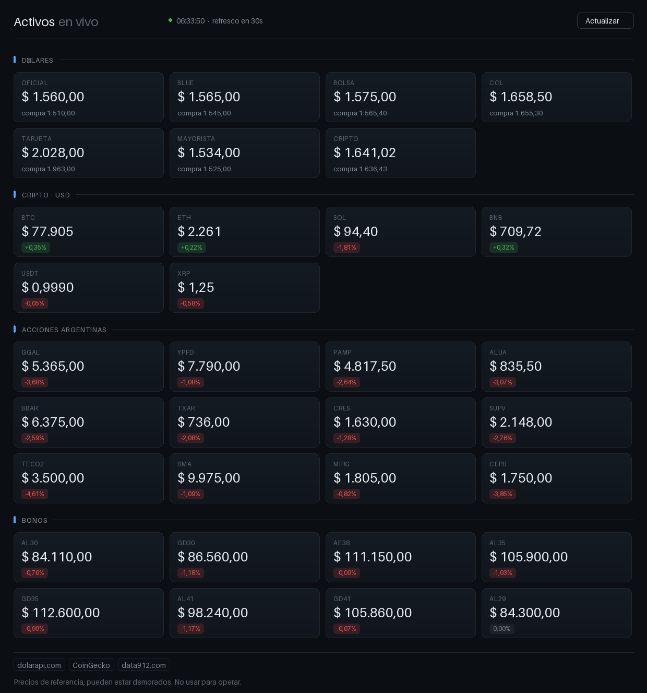

# activos-en-vivo

Una sola página que muestra, sin recargar ni registrarse, las cotizaciones del día de los
dólares, las principales criptomonedas, doce acciones argentinas y ocho bonos soberanos.

Sirve para mirar el mercado de un vistazo: reemplaza tener cinco pestañas abiertas en sitios
distintos y funciona como panel de escritorio o como pantalla fija en un segundo monitor.



## Qué muestra

| Bloque | Contenido |
| --- | --- |
| Dólares | Oficial, blue, bolsa, contado con liquidación, tarjeta, mayorista y cripto, con compra y venta |
| Cripto | BTC, ETH, SOL, BNB, USDT y XRP en dólares, con variación |
| Acciones argentinas | Doce papeles con la variación del día |
| Bonos | AL30, GD30, AE38, AL35, GD35, AL41, GD41 y AL29 |

Cada bloque carga por separado: si una fuente no responde, ese bloque muestra el error y los
demás siguen funcionando.

## Cómo se usa

Se abre `index.html` en cualquier navegador con conexión. No hay que instalar nada, ni
compilar, ni servir la página desde un servidor.

- Se actualiza sola cada 30 segundos, con una cuenta regresiva visible en el pie.
- El botón **Actualizar** consulta en el momento, sin esperar el ciclo.
- La hora de la última carga queda a la vista para saber si el dato está fresco.

## Cómo funciona

Un único archivo con el HTML, los estilos y el código. Cuatro pedidos en paralelo a APIs
públicas, cada uno con su propio manejo de error, y el resultado se dibuja en el DOM.

No hay backend ni clave de API: las consultas salen del navegador, así que el proyecto
depende de que cada API permita CORS.

## Fuentes

| Bloque | Endpoint |
| --- | --- |
| Dólares | `dolarapi.com/v1/dolares` |
| Cripto | `api.coingecko.com/api/v3/simple/price` |
| Acciones | `data912.com/live/arg_stocks` |
| Bonos | `data912.com/live/arg_bonds` |

Las cuatro son gratuitas y no piden credenciales.

## Límites

- Los precios son de referencia y pueden venir demorados; la página lo aclara en el pie.
- No hay historial ni gráficos: muestra el último valor de cada activo.
- Si una API cambia el formato de respuesta o deja de permitir CORS, ese bloque deja de cargar.
- No hay historial, gráficos ni alertas: muestra el último valor de cada activo.

## Estructura

```
index.html    página completa: maquetado, estilos y lógica
preview.png   imagen de referencia del diseño
```

## Licencia

MIT. Ver `LICENSE`.
